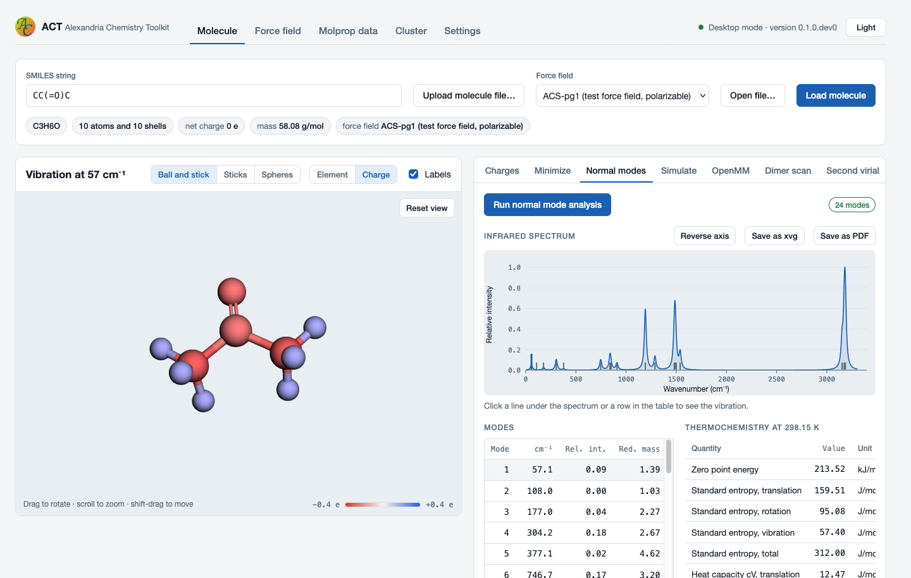
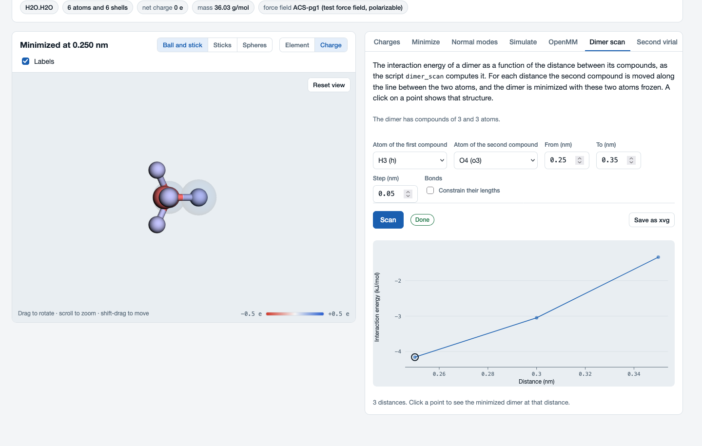
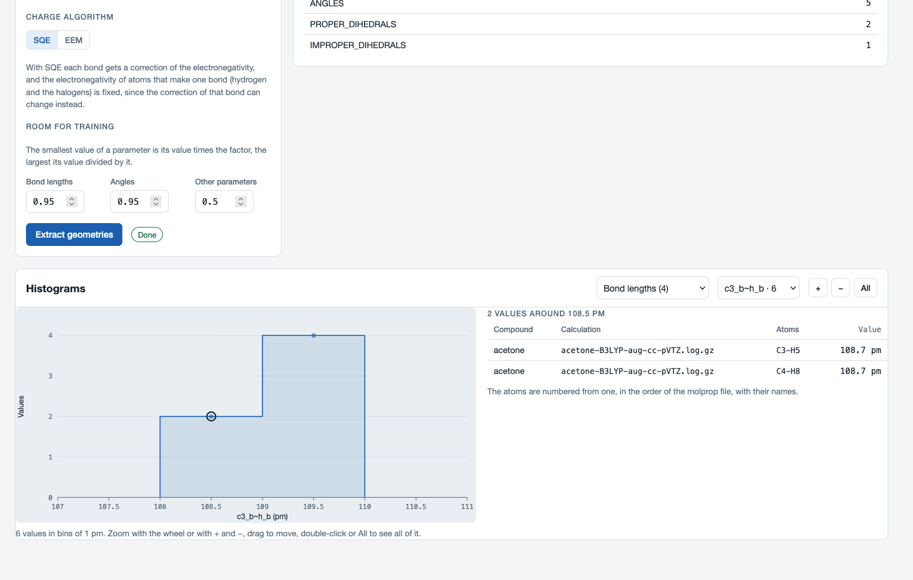
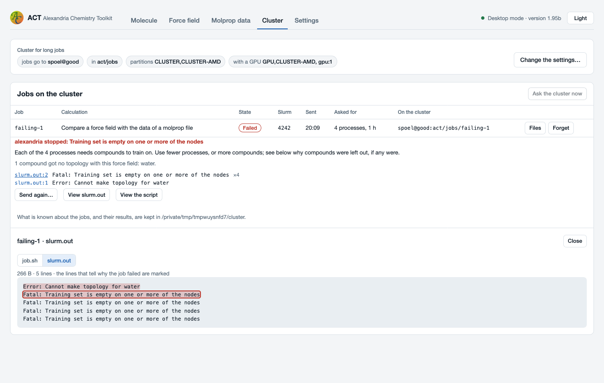

.. _sec-gui:

*****************************
The graphical user interface
*****************************

ACT-GUI is a user interface for ACT that runs in a web browser. A small server on your own computer runs the commands of *alexandria* through the Python package of :ref:`sec-python`, and a page shows the results: molecules in three dimensions with their charges, spectra, force fields, and how well a force field reproduces reference data. Long calculations can be sent from the page to a cluster on which you have an account. The interface is a repository of its own, `ACT-GUI`_, which replaces the program *actgui* of ACT-utilities.

Everything the interface does, it does by running *alexandria* with options that it shows or that this manual describes, so a calculation that was tried in the interface can be repeated on the command line or in a script.

.. _ACT-GUI: https://github.com/AlexandriaChemistry/ACT-GUI

========================
Installing and starting
========================
The conda package *act-gui* brings everything along: ACT with its Python package (the package *alexandria-python*), the web server and `plotXVG`_ for PDF files.

.. code-block:: bash

   conda install -c alexandriachemistry -c conda-forge act-gui
   act-gui

Without conda the interface needs ACT with its Python package, and Python 3.9 or newer with the packages *fastapi* and *uvicorn*; to save plots as PDF files it uses plotXVG when that is installed. From a copy of the repository:

.. code-block:: bash

   pip install ".[plots]"
   act-gui

The script *actgui* in the repository starts the interface from there without installing it, with the Python of the directory *.venv* there if there is one; the Python package of ACT and *alexandria* are then found through *PYTHONPATH* and *ACT_ALEXANDRIA*. An installed interface also has the program *actgui*, the name of the program it replaces.

*act-gui*, *actgui* or *python -m act_gui* prints an address and opens it in the browser. The server listens on your own computer only, and the address has a key without which it does not answer. Uploaded files and results are kept in a temporary directory that is removed when the program ends; *--data DIR* keeps them in a directory. *--no-browser* does not open a browser and *--port* chooses the port.

The interface finds *alexandria* as the Python package does: the program the package was installed with, or the one in the environment variable *ACT_ALEXANDRIA*. Calculations on more than one process need *mpirun*, *mpiexec* or *srun* in the *PATH*, or the launcher in *ACT_MPIEXEC*.

.. _plotXVG: https://github.com/AlexandriaChemistry/plotXVG

======================
The molecule workspace
======================
A molecule is given as a SMILES string or as a file, and is read with the default force field, the force field of the force field workspace or a force field file. The viewer shows it coloured by element or by charge, and the tabs run the calculations for one molecule (:numref:`fig-gui-molecule`):

* *Charges*: the charges and the topology (*alexandria gentop*).
* *Minimize*: an energy minimization (*minimize*), with the minimized structure on top of the original one, the RMSD and the energy terms.
* *Normal modes*: the vibrations (*nma*) with the infrared spectrum, the animated modes and the thermochemistry. The spectrum can be saved as a PDF file or as the xvg file of *nma*.
* *Simulate*: a short molecular dynamics simulation (*simulate*), with the energies plotted while it runs and the trajectory animated afterwards.
* *OpenMM*: an archive with which the molecule is simulated with OpenMM and the same force field, see :ref:`sec-simulations`. With a cluster set, the simulation itself can run there (:ref:`sec-gui-cluster`).
* *Dimer scan*: for a structure of two compounds, the interaction energy as a function of the distance, as the script *dimer_scan* of ACT-utilities computes it (:numref:`fig-gui-dimer-scan`). An atom of each compound is chosen (the closest pair is proposed), and for each distance the second compound is moved along the line between them and the dimer is minimized with these two atoms frozen, optionally with the bond lengths constrained. The plot grows while the scan runs; a click on a point shows the minimized dimer at that distance.
* *Second virial*: the second virial coefficient of a dimer, B2(T), with its classical part and the corrections for the force and the torque (*alexandria b2*), on several processes or on a cluster.

   The molecule workspace after a normal mode analysis of acetone. The atoms are coloured by charge; a click on a line under the spectrum or on a row of the table animates that vibration.

   A scan of the water dimer: the interaction energy against the distance between the two atoms that are frozen, and the minimized dimer at the point that was clicked.

=========================
The force field workspace
=========================
This workspace has one force field at a time, which is made there or opened from a file. Each step writes a new file that can be saved and that the other workspaces can use.

* *Generate* makes a new force field with *alexandria gen_ff* from a few choices: the charge model, the potentials with their combination rules, the atom types and which of them get a shell, and virtual sites. Parameters with a known value are fixed at that value from a file with a line *interaction|potential|atom type|parameter|value|unit* for each.
* *Virtual sites* defines sites by picking two, three or four atoms of a molecule in the viewer and choosing the kind of site; the site is shown where it would be. The sites can be saved in the file format of *gen_ff -vs*, and such a file can be opened.
* *Geometry* takes bond lengths, angles and dihedral angles from the compounds of a molprop file (*geometry_ff*): a file of its own, or the file of the molprop workspace with the compounds that are ticked there. A histogram of each bond, angle or dihedral type shows the values (:numref:`fig-gui-geometry`); a click on a bar lists the compounds, calculations and atoms that the values in it come from, which helps to find a structure that is not right; a click on one of these shows its structure with the atoms of the bond or angle marked. The bond lengths and angles of each type are also tested for a normal distribution (*geometry_ff -analyse*): the page tells how many types are not normal and how many have a standard deviation above the tolerance, and lists them with their p-value, skewness and kurtosis; a click on one shows its histogram.
* *Edit and validate* lists the parameters with their value, bounds and whether they are trained (:numref:`fig-gui-forcefield`), changes them with *edit_ff*, and shows the problems that *edit_ff -validate* finds. Of a particle type the charge and the width of its distribution can be changed, not the mass.
* *Compare* lists what differs between the force field of the workspace and another one: parameters with another value, with other bounds or another way of training, and those that only one of the two has.

.. figure:: ../images/gui-forcefield.png
   :name: fig-gui-forcefield
   :width: 100%
   :align: center

   The parameters of a force field. The bar shows where a value is between its bounds; a click on a row opens the form to change the value, the bounds or whether the parameter is trained.

   The histogram of a bond type from *geometry_ff*, with the compounds and atoms of the values in the bar that was clicked.

=======================
The molprop workspace
=======================
A molprop file with compounds and their reference data is opened and checked (*edit_mp -validate*). Under the name of the file the page shows the problems that were found and the number of values of each property; a click on a property shows only the compounds that have it. Calculations that are in the file twice with the same results, which *train_ff* uses once, are reported, and *Remove them and save* writes the file without them (*edit_mp -o*). The table of compounds can be sorted by each column, and a click on a compound shows its details under the table. The table also says what each compound is used for: training, testing or nothing. A click changes that for one compound, and the buttons above the table for all compounds that the table shows.

**Selection files.** The choices of the table make the selection file that *train_ff* reads with *-sel*, see :ref:`sec-files`: a line for each compound that is used, with *Train* or *Test*. The box in front of a compound says whether it is used, and the box in the header does so for all compounds that the table shows, which can be limited to those that have values of one property. For a file with dimers the card *Selection file* lists the monomers, and ticking monomers chooses the dimers they are in: with the dimers A#B, A#C and B#C, ticking only A gives A#B and A#C but not B#C. The other setting uses a dimer only when all its monomers are ticked. *Draw at random* uses a percentage of the ticked compounds for testing. *Save* writes the file, named after the molprop file with the extension *.dat*, and *Open* reads a selection file that exists already: the table then says what the file says, and compounds of the molprop file that the selection does not have are not used. A comparison or a training, on your own computer or on a cluster, uses what the table says at that moment.

**Comparing.** A force field is compared with the data of the file by *train_ff -nooptimize*, for the properties that are chosen. The page shows the statistics for each property and data set and a plot of the values of the force field against the reference values (:numref:`fig-gui-comparison`), which can be saved as a PDF file. For a compound with several structures, such as a dimer, a histogram shows the energies of the reference and of the force field.

.. figure:: ../images/gui-comparison.png
   :name: fig-gui-comparison
   :width: 100%
   :align: center

   A force field compared with the interaction energies of dimers: each point is a structure, and the dashed line is where the force field equals the reference.

**Training.** With *Train* instead of *Compare* the force field is trained on the data (*train_ff*). The force field offers the kinds of parameters that are not fixed, each property has a weight, and the optimizer is Monte Carlo or the genetic algorithm with or without Monte Carlo, see :ref:`sec-performance` for what they need. *train_ff* has one set of parameters for each process, so the number of processes is the size of the population, which the genetic algorithm needs to be even. The compounds for testing are those that the table says, or a percentage that is drawn at random with a fixed seed. Note that *train_ff* starts from random values of the parameters unless *From random values* is switched off.

The page follows a training with a plot of :math:`\chi^2` (:numref:`fig-gui-training`) and can stop it. Afterwards it lists the trained parameters with the result of the sensitivity analysis, compares the trained force field with the data, and shows what the training changed. The trained force field can be saved or opened in the force field workspace. A calculation on your own computer may take ten minutes, and a job on a cluster the time it asks for. A training is told to stop somewhat before that (*train_ff -maxh*) and then ends in order, with the best force field it found; the page says that its time was up. Longer trainings belong on a cluster.

*Continue training* sets the form up to train further from a training that is done: the next one starts from the trained force field instead of random values, and with the genetic algorithm also from the individuals that the earlier training ended with (*-gpin*), for which it needs as many processes as there were individuals. Monte Carlo alone continues from the force field only. A training that stopped because its time was up is continued in the same way.

.. figure:: ../images/gui-training.png
   :name: fig-gui-training
   :width: 100%
   :align: center

   A short training: the lowest :math:`\chi^2` so far, and the parameters of the trained force field.

==================
Settings
==================
The tab *Settings* has the screen mode and the cluster for long jobs. The screen is light, dark (white on black) or hippy (yellow on dark purple, with orange borders); the button at the right of the top bar goes to the next mode. The choice is kept with the other settings, and the page starts in it the next time.

.. _sec-gui-cluster:

==================
Jobs on a cluster
==================
Long calculations, a comparison with a large file, a training, the second virial coefficient or a simulation with OpenMM, can run on a Slurm cluster on which you have an account. In the tab *Settings* you give the name of the server, your user name there and a working directory; how ACT is made available in a job (a module, a file that the shell reads, a conda environment, or nothing); the partitions for jobs with and without a GPU; and the name of the program there, *alexandria* or *alexandria_d*. The settings are kept in the file *act-gui/settings.json* in your configuration directory.

The interface logs in with the *ssh* program of your computer, which uses your own keys and settings. It never asks for a password and keeps none, so the login has to work without a question: set up a key for the server, or open one connection in a terminal with connection sharing if the server asks for a password or a code each time. *Test the login* logs in once and tells whether the directory is there and the server has Slurm.

A cluster may block an account that logs in often, so the interface logs in as seldom as it can:

* Before anything is sent, the page shows the job: the script for Slurm, the command and the files that go along. The files get a name after their option, such as *ff.xml*, so no name of a file on your computer goes to the cluster.
* Sending a job is one login. The files go to a directory of the job below the working directory, where *sbatch* is started.
* One login asks for the state of all jobs together, not more often than the settings say (every two minutes by default), and only while the page is open. A training also tells how far it is (:numref:`fig-gui-cluster`).
* When a job has ended, one more login fetches its results, which are then shown as those of a calculation on your own computer. All output files come back, also those that the program writes under a name of its own, such as the log file of *train_ff*; *Files* lists them and saves each.
* After a login that did not work the cluster is not asked again until you press the button.

What is known about the jobs is kept on your computer, so they are still listed when the interface is started again. *Stop* cancels a job with *scancel*. Nothing is ever removed on the cluster: the directory of a job stays there until you remove it.

The program on the cluster has to know the options that the *alexandria* of your computer uses, so the two should be of the same version; a training needs *train_ff -progress*. A simulation with OpenMM runs the script of the archive with *python3*, so OpenMM and ACT-utilities have to be in the environment that the settings load.

.. figure:: ../images/gui-cluster.png
   :name: fig-gui-cluster
   :width: 100%
   :align: center

   The jobs on the cluster, with how far a training was when the cluster was last asked.

.. _sec-gui-failed-jobs:

-----------
Failed jobs
-----------
A job that failed says why, under its row in the tab *Cluster* (:numref:`fig-gui-cluster-failed`). The interface reads the output of Slurm and the log files that came back, and picks the lines that tell:

* the message with which *alexandria* stopped, told once with the number of processes that printed it;
* compounds that got no topology with the force field, and the atom types or parameters that it lacks for them;
* *mpirun* that found fewer cores than the job has processes;
* a program, module or conda environment that the job did not find;
* the time limit, memory, the GPU, or a crash.

With the reason comes what to change: fewer processes, more time, the settings of the cluster, or the input of the calculation. Each line that tells opens the file it is from at that line, and the output, the log and the script of the job can be read on the page, with these lines marked.

*Send again* makes a new job of one that is done, with other processes, time or GPU, and the settings of the cluster as they are now. It is called after the old one, with *-r2*, *-r3* and so on, and the page shows it before it is sent. Its files are copied from the directory of the old job on the cluster, so nothing is sent from your computer, also when the interface was started again in between. The number of individuals of a training and the time at which it stops (*-maxh*) follow the new job. A job with other input, such as another force field or other compounds, is sent from its tab.

   A comparison on four processes that failed: the reason, what to change, and the lines of the output that tell it, which are marked in the output below.
